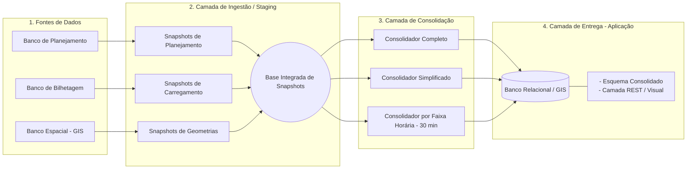

Este repositório contém a arquitetura da plataforma de dados, pipeline de ETL e dashboards para análise de indicadores de mobilidade e transporte público.

---

## ⚙️ Arquitetura e Engenharia do Pipeline de ETL

A plataforma utiliza um pipeline automatizado de extração, transformação, enriquecimento espacial e carga (ETL), projetado sob o conceito de **Tabelas de Snapshot e Histórico Incremental**.

> **Nota de Governança e Privacidade**: Em conformidade com as diretrizes de segurança da informação e LGPD, as strings de conexão direta, credenciais de acesso e estruturas brutas de bancos corporativos legados foram omitidas deste repositório público. A documentação abaixo foca exclusivamente na arquitetura lógica e metodológica da solução.

---

### 🏗️ Diagrama de Fluxo de Dados

Este repositório contém a arquitetura da plataforma de dados, pipeline de ETL e dashboards para análise de indicadores de mobilidade e transporte público.

### 🔄 Etapas do Processamento de Dados

#### 1. Ingestão e Sanitização Multiorigem
* **Sistema de Planejamento Operacional**: Fonte dos dados operacionais teóricos (linhas cadastradas, quadro de horários e frota alocada).
* **Sistema de Bilhetagem Eletrônica**: Fonte dos dados de carregamento (passageiros pagantes, gratuidades, estudantes, integrações e validações de frota operante).
* **Banco de Dados Geográfico (GIS)**: Base espacial contendo as geometrias vetoriais dos itinerários (com projeção Cartográfica UTM / SIRGAS 2000).

#### 2. Normalização e Modelagem da Chave Primária Universal (`ID_LINHA`)
Para superar a heterogeneidade das fontes legadas e viabilizar a modelagem dimensional do painel, foi desenvolvida a arquitetura de uma **Chave Primária Sintética Universal**. Esta abordagem resolve os conflitos de cardinalidade e padroniza a granularidade dos dados entre os sistemas de planejamento, bilhetagem e geoprocessamento:

```text
[Chave Primária Universal] = [Código do Serviço (4 dígitos)] + [Sentido Operacional (1 dígito)] + [Identificador da Região/Bacia (1 dígito)]
```

#### 3. Segregação por Modais
Os dados de bilhetagem e planejamento são segregados automaticamente para garantir métricas isoladas e consistentes:
* **Serviço Urbano**: Linhas convencionais do sistema rodoviário.
* **Serviço Rural**: Linhas de áreas rurais.
* **Corredores de Alta Capacidade**: Linhas expressas e estruturantes.
* **Tratamento de Exceções**: Isolamento de catracas de solo.

#### 4. Validação Espacial e Consistência de Dados Geográficos
Cada registro consolidado passa por um módulo de verificação de integridade e qualidade da informação espacial que:
- Avalia a correspondência entre os registros do sistema de bilhetagem e a base de traçados vetoriais do GIS.
- Aplica sinalizações de controle de dados (`MOTIVO_SEM_GEOMETRIA`, `FLG_DIVERGENCIA_SENTIDO`) como ferramentas de auditoria para o gestor, identificando pendências de sincronização entre bancos, linhas aguardando mapeamento ou registros de pontos fixos (como catracas de solo e estações).

#### 5. Consolidação e Cálculo de Indicadores de Desempenho
O pipeline calcula mais de 50 indicadores operacionais e financeiros, divididos em visões completas e por faixa horária (30 minutos):
* **Oferta e Demanda**: Lugares Ofertados, Quilometragem Operada, IPK (Passageiros por Quilômetro) e IRP (Índice de Renovação de Passageiros).
* **Apropriação Financeira**: Arrecadação Tarifária, Custo do Serviço, Tarifa Técnica Vigente e Valor Estimado de Subsídio.

## 🛠️ Tecnologias Utilizadas

* **Linguagem**: Python 3.12
* **Banco de Dados**: PostgreSQL 15+ / PostGIS hospedado no Supabase
* **Bibliotecas**: Pandas, GeoPandas, SQLAlchemy, Psycopg2, Streamlit e FastAPI

## ⚖️ Aviso Legal e Isenção de Responsabilidade (Disclaimer)

* **Caráter Educativo e Demonstrativo**: Este repositório foi desenvolvido estritamente para fins de demonstração de arquitetura de dados, portfólio técnico e estudo de Engenharia de Software/Dados.
* **Anonimização e Dados Sintéticos**: Todos os dados, exemplos e tabelas utilizados nesta demonstração são puramente **sintéticos, genéricos e/ou anonimizados**, não representando valores reais, operacionais ou financeiros de qualquer entidade pública ou privada.
* **Ausência de Código Proprietário**: Não há inclusão de credenciais, chaves de acesso, queries restritas ou componentes de propriedade intelectual exclusiva de terceiros neste repositório público.
